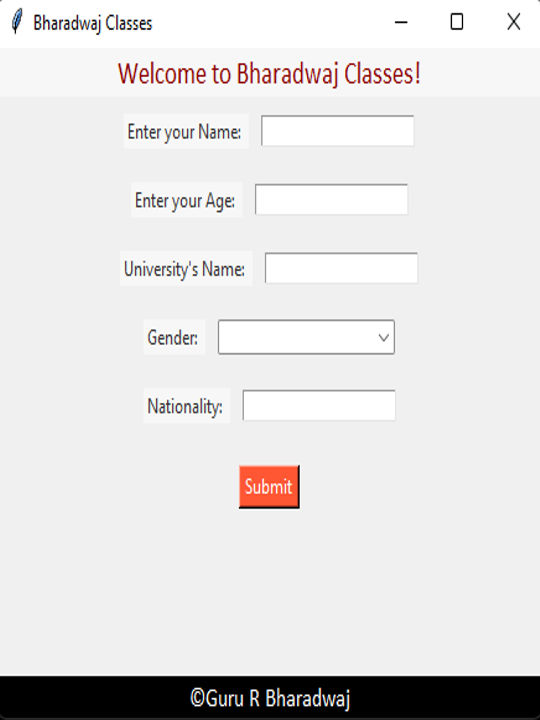
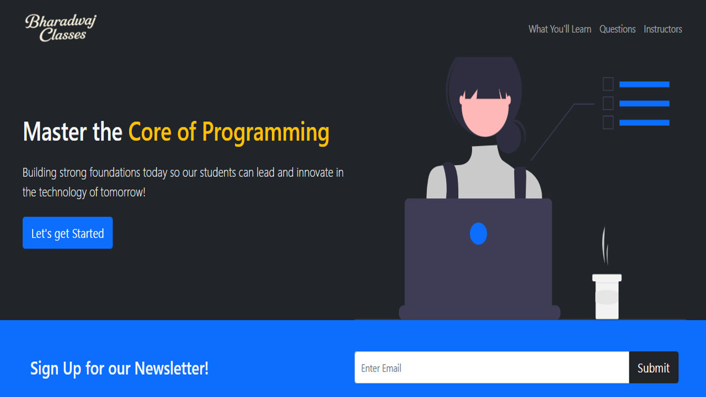
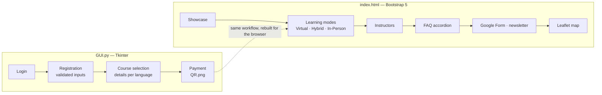
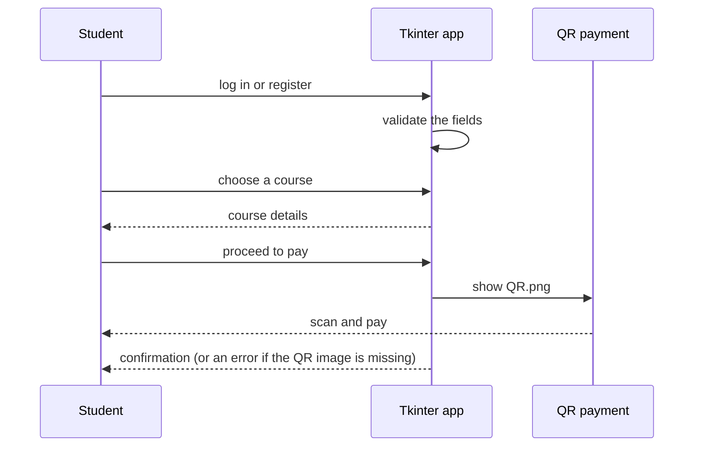

# Bharadwaj Classes

<p align="center">
  <a href="Bharadwaj_Classes%20Demo.mp4">
    
  </a>
  <br>
  <sub>▶ <b><a href="Bharadwaj_Classes%20Demo.mp4">Watch the Bharadwaj_Classes demo</a></b> (74 s): the feature table and commits, the README quick start on a fresh clone, then both versions live: the Tkinter app from login to the QR payment, and the Bootstrap site in Chrome</sub>
</p>

**One coaching-centre experience built twice — as a Tkinter desktop app and as a responsive Bootstrap website.**

[](GUI.py)
[](Bharadwaj%20Classes%20using%20Bootstrap/index.html)
[](Bharadwaj%20Classes%20using%20Bootstrap/)
[](#license)

For the fictional "Bharadwaj Classes": a student registers, logs in, picks a
course in one of three learning modes, and pays by QR code. The desktop version
came first; the website rebuilds the same workflow for the browser and adds the
things a public site needs.

---

## Contents

| Section | |
|---|---|
| [What it does](#what-it-does) | The two versions, side by side |
| [Architecture](#architecture) | Desktop flow and web page structure |
| [How a student enrols](#how-a-student-enrols) | Register, choose, pay |
| [Quick start](#quick-start) | Run the app, open the site |
| [Project status](#project-status) | What each version covers |
| [Design decisions](#design-decisions) | Why rebuild it for the web |
| [Repository layout](#repository-layout) | Where things live |
| [Team](#team) | Who built it |

---

## What it does

| Area | Tkinter app | Bootstrap website |
|---|---|---|
| **Accounts** | Login and registration with input validation (e.g. digits-only age) | Modal sign-up and an embedded Google Form |
| **Courses** | Course selection with details per language | Course cards for Virtual, Hybrid and In-Person modes, with pricing and benefits |
| **Payment** | QR-code payment confirmation | — |
| **Information** | — | Instructor cards, an FAQ accordion, a newsletter sign-up, a live Leaflet map |
| **Layout** | Fixed desktop window | Fully responsive, Bootstrap Icons |

<p align="center">
  
  &nbsp;
  
</p>

---

## Architecture



---

## How a student enrols



---

## Quick start

```bash
# desktop app — Python 3 with Tkinter; run from the repo root so QR.png is found
python GUI.py

# website — no server or install
#   open "Bharadwaj Classes using Bootstrap/index.html" in a browser
```

---

## Project status

Both versions are complete for their scope. The website was added in July 2025,
eight months after the desktop app, as a rebuild of the same workflow.

| Version | Status |
|---|---|
| Tkinter desktop app | ✅ login, registration, course selection, QR payment |
| Bootstrap website | ✅ responsive landing site with forms, FAQ and map |

---

## Design decisions

**Rebuild, don't port.** The website keeps the desktop app's flow — choose a
mode, see what it costs, sign up — but uses the web's own patterns: modals,
accordions and an embedded form instead of extra windows.

**Static on purpose.** The site is plain HTML, CSS and Bootstrap from a CDN, so it
opens from the filesystem with nothing to install or host.

**Three learning modes.** Virtual, Hybrid and In-Person, each with its own price
and benefits, mirror how real coaching centres sell courses.

---

## Repository layout

```
.
├── GUI.py                                Tkinter desktop app
├── QR.png                                payment QR used by the app
├── Bharadwaj Classes using Bootstrap/
│   ├── index.html                        the website
│   ├── style.css
│   └── img/                              logo and illustrations
└── img/                                  screenshots for this README
```

---

## Team

| Member | Focus |
|---|---|
| **Guru R Bharadwaj** | Both versions — desktop app and website |

---

## License

Built for academic and portfolio purposes. The branding is fictional.
**Redistributing or presenting this project as your own is prohibited.**
